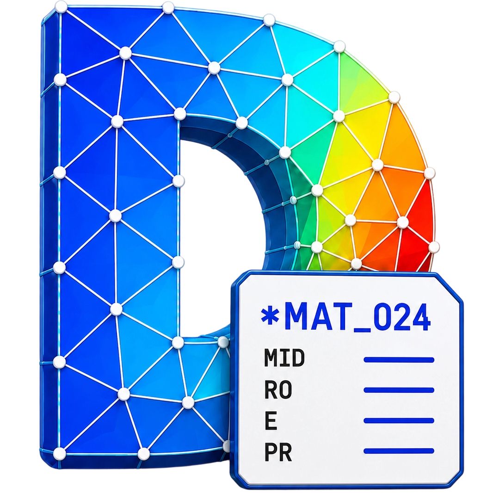
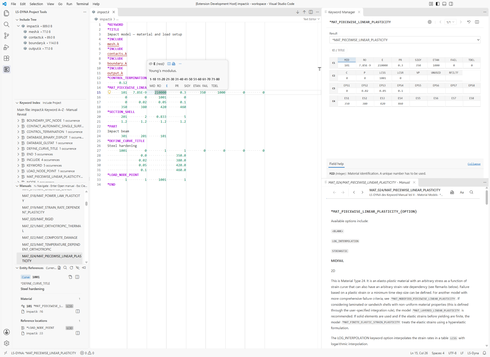
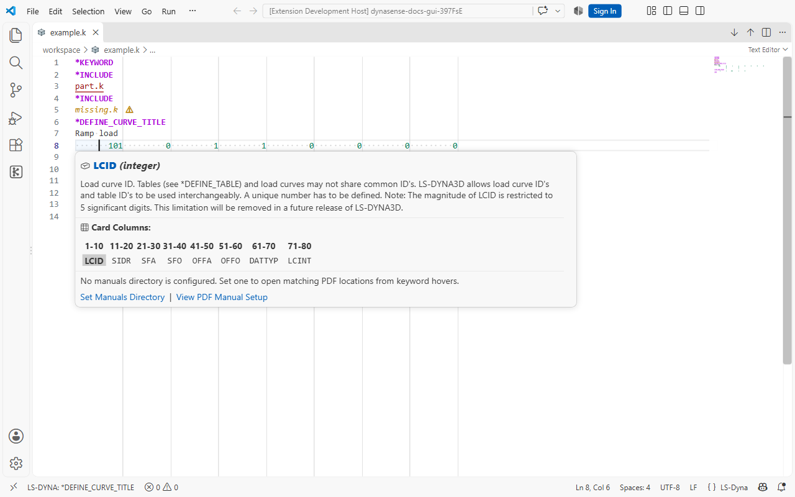
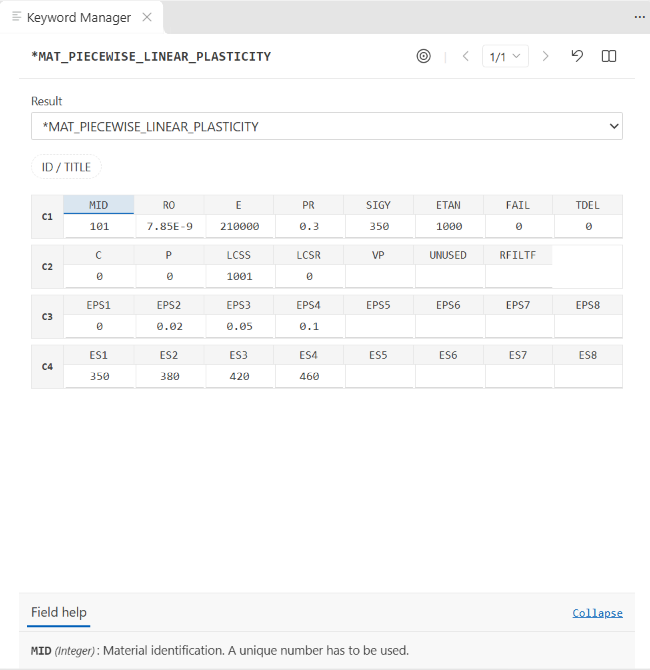
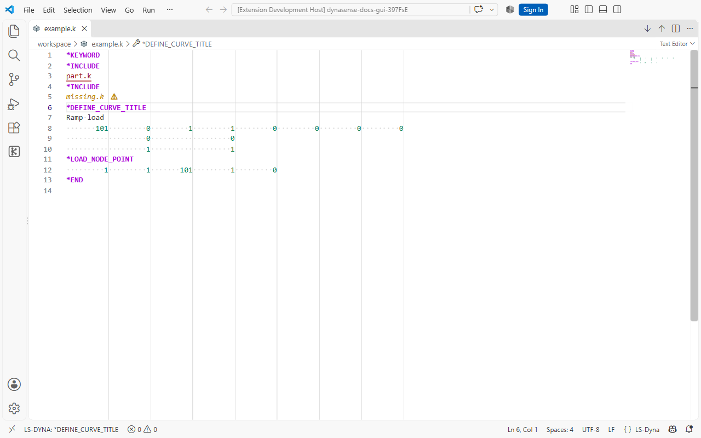

# DynaSense (LS-DYNA Studio)

  
  <h3>Dedicated LS-DYNA Keyword Deck Editor for VS Code</h3>
  
LS-DYNA (.k) deck editing assistant, with quick keyword and manual lookup.

[English Version](README.md) | [中文说明](README_zh.md) | [Product website](https://pencilq.com/dynasense/)

---

## Quick Start

### 3-Step Setup

1. **Install Extension**: Search for DynaSense in the VS Code Marketplace and install it.
2. **Open a Model Deck**: Open any .k, .key, or .dyna file (main deck or included file).
3. **Start Productive Editing**:
   - Type `*` to insert keywords with pre-formatted cards;
   - Hover over fields to view parameter definitions;
   - Scan model relationships directly from **LS-DYNA Project Tools** in the activity bar.

### Key Shortcuts

| Shortcut | Action | Description |
| :--- | :--- | :--- |
| Tab / Shift+Tab | Jump fields | Navigate through card fields like Excel cells |
| Delete / Backspace | Clean without shifting | Clears a selected supported field with spaces, preserving subsequent columns |
| `$` or `$#` | Insert header | Instantly generate aligned comment headers for field names |
| Ctrl + / | Toggle comment | Quick toggle for LS-DYNA `$` comment lines |
| Ctrl + Alt + Up/Down | Jump keyword | Move directly to the previous / next keyword |
| F2 | Rename parameter | Rename &param across the current document |

After scanning the main deck in the Include Tree, type `&` in a supported numeric field to complete parameters. Use **Go to Definition**, **Peek Definition** and **Find References** to navigate parameter usage across included files.

---

## Key Features

### 1. Fixed-Width Card Editing: Excel-like Editing with Misalignment Protection

When editing .k files in ordinary text editors, an accidental keystroke or deletion often shifts subsequent numbers, causing syntax errors during solver submission.

DynaSense provides built-in column width protection:
- **Smart Navigation**: Press Tab to navigate through fixed-width fields. Typing replaces fields selected through Tab; typing `*` or `$` retains normal editing behavior.
- **Misalignment Protection**: Pressing Delete or Backspace clears the selected field and pads with spaces so subsequent columns stay perfectly in place.
- **Keyword Manager**: Open the card manager from keyword hover actions to preview and inspect field modifications before saving them back to the deck.

### 2. Instant Manual Help & Curve Previews: No More Flipping Through PDFs

- **Hover Manual Assistance**: Hover over supported keywords or fields to see parameter descriptions and engineering significance.
- **Graphical Curve Previews**: Hover over load curve fields (such as LCID referencing `*DEFINE_CURVE`) to render curve plots and supported table previews directly inside VS Code.
- **Side-by-Side Manual Reader**: Read local official manuals side-by-side with your deck files.

### 3. Full-Vehicle Include Tree Navigation

Modern simulation models often contain dozens or hundreds of `*INCLUDE` files:
- **Hierarchical Tree View**: Scan the main deck to inspect the detected include hierarchy in the sidebar. Double-click to jump directly to any sub-file.
- **Cross-File Parameter Resolution**: Automatically respects `*INCLUDE_PATH` and evaluates parameters across included decks.

---

## Local Manual Setup

Official PDF manuals can be viewed locally offline:

| Manual Pack | Download |
| :--- | :--- |
| **Bilingual** | [Download lsdyna-manual-pack-bilingual.zip](https://github.com/hqyyqh/vscode-lsdyna/releases/download/2.0.7.3/lsdyna-manual-pack-bilingual.zip) |
| **English** | [Download lsdyna-manual-pack-en.zip](https://github.com/hqyyqh/vscode-lsdyna/releases/download/2.0.7.3/lsdyna-manual-pack-en.zip) |

Manual packs updated: 2026-10-18.

**Official documentation:** The [Ansys LS-DYNA manuals download page](https://lsdyna.ansys.com/manuals-download/) provides the official original documents. The ZIP files above are local manual packs for use with the extension.

Chinese and bilingual reading require a manual pack containing translations; changing the UI language does not add translations to the English pack. In-editor help and translations are reading aids; use the official PDF as the technical reference.

### Setup Steps:
1. Download and extract the manual pack to a local folder (e.g. D:\LS-DYNA\Manuals).
2. Press Ctrl + Shift + P in VS Code, run **Set LS-DYNA Manuals Directory**.
3. Choose **Select folder**, then select the extracted root folder containing manifest.json.
4. Run **LS-DYNA: Open Manual Reader** or click the **Manuals** view in the activity bar.

> **Tip for Windows:** Place [SumatraPDF.exe](https://www.sumatrapdfreader.org/free-pdf-reader) in the manual pack folder or its pdf subfolder to jump directly to specific pages in the official PDF.

---

## Settings

Most features work out of the box. Useful settings in VS Code Preferences (`Ctrl + ,`, search `LS-DYNA`):

- lsdyna.manualsDir: Path to your local extracted manual pack folder.
- lsdyna.language: UI display language (auto, zh-cn, or en).
- lsdyna.enableCellEditProtect: Prevents column shifting on Delete/Backspace (enabled by default).
- lsdyna.enableTabNavigation: Smart Tab jumping between fields (enabled by default).

All settings and defaults

| Setting | Default | Description |
| --- | --- | --- |
| `lsdyna.manualsDir` | `"lsdyna_manual_pack"` | Root folder of a manual pack, containing its runtime indexes and PDF manuals. Use an absolute path or a path relative to the workspace. On Windows, place SumatraPDF.exe in the pack root or its pdf subfolder to enable precise page jumps. |
| `lsdyna.enableTabNavigation` | `true` | Enable smart Tab navigation and field overwrite selection in LS-DYNA cards. When disabled, Tab inserts spaces or tab characters normally. |
| `lsdyna.enableCellEditProtect` | `true` | With this enabled, Delete or Backspace clears a selected fixed-width field with spaces so later fields do not shift. Typing replaces the whole field only after Tab selects it; * and `$` always use standard text editing. This setting is independent of Tab navigation. |
| `lsdyna.enableFieldHover` | `true` | Show help when the pointer rests on a fixed-width card field. Turn this off to avoid field popups while editing; turn it back on from DynaSense quick actions. |
| `lsdyna.changeMarks.enabled` | `true` | Show session change marks in the editor gutter. By default, amber marks are unsaved and green marks were saved after the file was opened. A solid bar means modified, a hollow bar means inserted, and a triangle marks a nearby deletion. Git is not required. |
| `lsdyna.changeMarks.colorScheme` | `"adaptive"` | Choose one color scheme for all session change marks. Every preset automatically adjusts for light, dark, high-contrast, and high-contrast-light themes. |
| `lsdyna.changeMarks.customUnsavedColor` | `"#e2a03a"` | Custom color for unsaved changes, in #RRGGBB format. Used only when Change Marks: Color Scheme is Custom. |
| `lsdyna.changeMarks.customSavedColor` | `"#89d185"` | Custom color for changes saved since the file was opened, in #RRGGBB format. Used only when Change Marks: Color Scheme is Custom. |
| `lsdyna.changeMarks.maxLineCount` | `100000` | Skip change marks when a document has more lines than this (protects very large mesh decks). |
| `lsdyna.changeMarks.debounceMs` | `250` | Milliseconds to wait after typing before recomputing change marks. |
| `lsdyna.changeMarks.showOverviewRuler` | `true` | Also show change marks on the overview ruler (scrollbar). |
| `lsdyna.changeMarks.showLineBackground` | `true` | Apply a very light background to marked lines. Turn this off to keep only the gutter marks. |
| `lsdyna.changeMarks.showMinimap` | `true` | Show unsaved and saved-since-open marks on the minimap using the selected color scheme. Modified, inserted, and deleted shapes remain in the editor gutter. |
| `lsdyna.navigation.pulseOnJump` | `true` | Highlight the target line briefly after jumping to a keyword usage. |
| `lsdyna.statusBar.level` | `"simple"` | Amount of information about the current LS-DYNA file shown in the status bar. Off hides the entry; Simple shows problems or the current keyword; Detail also shows the field index and latest Include Tree scan root. |
| `lsdyna.health.showFirstRunNotice` | `true` | Show a one-time DynaSense notice when an LS-DYNA file needs environment or manual setup. |
| `lsdyna.largeFile.enableRendering` | `true` | Keep syntax highlighting, hover help, and completion enabled for files of any length. Disable this to save memory when working with files above 100,000 lines. Explicit formatting has separate hard safety limits. |
| `lsdyna.codeLens.showOnAllKeywords` | `false` | Show Select Cards and Format actions above every LS-DYNA keyword. Keywords with optional suffixes also show Configure Options. When disabled, use the keyword hover actions, editor context menu, or Command Palette. |
| `lsdyna.hover.previewMaxLines` | `20` | Maximum number of lines to display in the `*INCLUDE` file hover preview. |
| `lsdyna.autoFormat` | `"disabled"` | Experimental: choose when automatic LS-DYNA card formatting runs. Keep this disabled unless you are comfortable with edits when the cursor leaves a line. |
| `lsdyna.language` | `"auto"` | Choose the language for the extension’s runtime UI, hover help and messages. Command names and setting descriptions follow the VS Code display language. |
| `lsdyna.additionalExtensions` | `[".k",".key",".dyna"]` | Additional filename extensions to treat as LS-DYNA files. |
| `lsdyna.scanner.fullScanLargeFiles` | `false` | Perform a full scan for the Include Tree and Keyword Index. When disabled, files larger than 500 KB are scanned only at the first and last 1,000 lines for better performance.  > *`*N`ote:** Enabling this for projects with very large mesh files can increase loading time. |
| `lsdyna.ignoreFormattingKeywords` | `[]` | Keywords or prefixes to exclude from the explicit LS-DYNA formatting command, smart Tab alignment, and field-comment completion. |
| `lsdyna.customValidKeywords` | `["*END","*TITLE","*CASE_BEGIN","*CASE_END"]` | Additional valid keywords that should not be reported as unknown. Include the leading asterisk (for example, '`*END`'). Add a trailing wildcard (for example, '`*MAT_*`') to match every keyword with that prefix. Entries can also be added from a hover or Quick Fix. |
| `lsdyna.unknownKeywordSeverity` | `"error"` | Diagnostic severity for keywords not found in the built-in library or custom valid list. This does not affect keywords beginning with ** or lowercase-keyword warnings. |
| `lsdyna.warnLowercaseKeyword` | `false` | Warn when a keyword contains lowercase letters (e.g. *node). LS-DYNA is case-insensitive, so this is off by default; enable it if your team keeps keywords uppercase. |
| `lsdyna.include.pathCaseCheck` | `"crossPlatform"` | How path casing is checked for `*INCLUDE` and `*INCLUDE_PATH`. Windows can open mismatched casing; Linux LS-DYNA usually cannot. |
| `lsdyna.cache.entityIndexMemoryMaxMiB` | `512` | Managed memory budget for model indexing in MiB, shared by query caches, unsaved document indexes, result pages, index build and restore batches and SQLite. This is not a limit on total VS Code process memory. Takes effect after the extension restarts. |
| `lsdyna.cache.entityIndexDiskMaxMiB` | `4096` | Shared disk budget for model indexes in MiB, including databases, journals and temporary build files. If the budget is exhausted, queries fall back to scanning. Takes effect after the extension restarts. |
| `lsdyna.cache.memoryMaxMiB` | `48` | Maximum memory cache for background project snapshots in MiB, up to 64 MiB. The UI keeps a separate project-summary cache of up to 32 MiB. Lower this value on memory-constrained workstations. Takes effect after the extension restarts. |
| `lsdyna.cache.fileScanMemoryMaxMiB` | `16` | Maximum memory cache for background file-scan results in MiB, up to 16 MiB. Takes effect after the extension restarts. |
| `lsdyna.cache.maxAgeDays` | `30` | Maximum idle age of persistent model indexes, up to 30 days. Expired entries are cleaned up when indexing is first used after the extension starts. Takes effect after the extension restarts. |
| `lsdyna.clearAutoIndentOnEnter` | `false` | Remove indentation copied by the editor after Enter in LS-DYNA files. Disabled by default to preserve intentional indentation and pasted text. |
| `lsdyna.keywordManager.allowUnauditedCatalog` | `false` | For development and troubleshooting only: allow keyword form data that has not passed review to be loaded. |

---

## Community & Feedback

Feedback, suggestions, and contributions are welcome!

- **Issues & Discussions**: [Submit a GitHub Issue](https://github.com/hqyyqh/vscode-lsdyna/issues)

---

## Acknowledgments

This project is built upon the work of the open-source community. Special thanks to:

- **[osullivryan/vscode-lsdyna](https://github.com/osullivryan/vscode-lsdyna)**: The original LS-DYNA extension for VS Code. Thanks to **Ryan O'Sullivan** (@osullivryan) and contributors **@DCHartlen**, **@maxiiss**, and **@yshl** for establishing the syntax highlighting and card editing foundations.
- **[ansys/pydyna](https://github.com/ansys/pydyna)**: Ansys's open-source library, which provides structured keyword card definitions and schemas.
- **[vim-lsdyna](https://github.com/gradzikb/vim-lsdyna)**: Created by **@gradzikb**, which provided reference for fixed-width column formatting.
