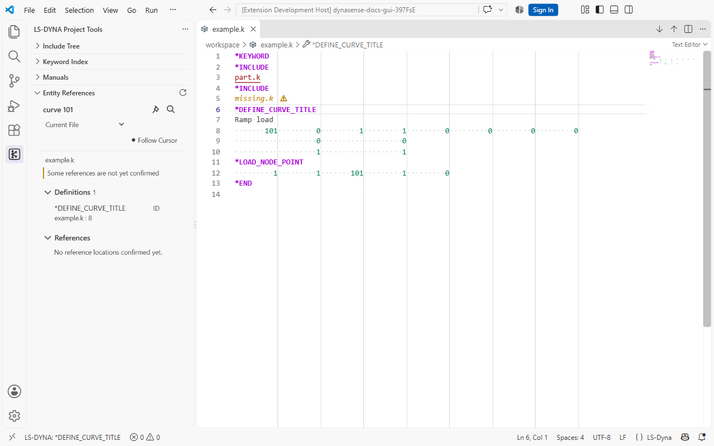

# DynaSense (LS-DYNA Studio)

  
  <h3>An LS-DYNA deck editor for VS Code</h3>
  
Keyword help, fixed-width card editing, Include Tree navigation, reference previews, and local manuals for CAE engineers.

[English Version](README.md) | [中文说明](README_zh.md)

---

## Quick start

Requires VS Code 1.100.0 or later. This page describes the 3.2.0 development version; marketplace versions may not yet include every feature. See the [changelog](CHANGELOG.md) for release status.

After installing DynaSense, start with these steps:

1. **Open a deck** — open a `.k`, `.key`, or `.dyna` file, whether it is a main deck or an included file.
2. **Insert a keyword** — type `*` to choose a keyword and insert its card layout.
3. **Edit by field** — press `Tab` / `Shift+Tab` on a data line. Delete clears the selected field without shifting later fields; typing after Tab replaces that field only.
4. **Read help and references** — hover a keyword, field, parameter, curve ID, or table ID.
5. **Scan the model** — open **LS-DYNA Project Tools** in the activity bar → **Include Tree**, then scan from the main file.

---

## Core workflows

### Edit keyword cards safely

- Keyword completion templates use data from the open-source [ansys/pydyna](https://github.com/ansys/pydyna) project. See [supported workflows](SUPPORT.md) for format and editing limits.
- Snippets insert formatted cards. Keyword hover actions let you select cards, formats, and optional fields where supported.
- `Tab` moves between fields using the supported card layout. After the last field, the next Tab returns to the first field on the **same data line**; it does not create or enter another line.
- Type `$` or `$#` to generate aligned field-header comments. `Ctrl+/` adds or removes the LS-DYNA `$` line comment marker.
- You can format cards or a selection explicitly. Use DynaSense’s own formatting command; the standard VS Code document and selection formatting commands are not provided by this extension. Layouts that cannot be changed safely are left unchanged.

### Review changes in the Keyword Manager

Open the Keyword Manager from a keyword's hover or quick actions. Select an instance from the current file or project, inspect the available card layouts and field help, then edit a draft. **View changes** shows the exact proposed edits, including linked changes to fields that occupy the same positions in the file. **Apply changes** applies that preview; **Discard changes** cancels unapplied edits. Undo, redo, save and reopen use the normal editor workflow. Changed or read-only documents require a fresh, writable state before application.

The manager uses the bundled card definitions. You can inspect layouts that have not been verified, but the manager will not edit them automatically. See [supported workflows and format boundaries](SUPPORT.md).

This example shows linked field changes. It illustrates the editing workflow, not a complete model ready to solve.

### Track this editing session

- Session change marks work without Git. The default amber/green colors automatically switch for light, dark, and high-contrast themes; you can instead choose an orange/blue, red/blue, high-contrast, or custom scheme in VS Code Settings. Different marker shapes distinguish modified, inserted, and deleted lines.
- Commands are available for next/previous mark, comparison with the opened or saved version, and resetting the baseline.
- Very large decks use limited scanning and can skip change marks to keep editing responsive. Enable a full scan only when complete indexing is needed and the additional load time is acceptable.
- To keep editing responsive, change marks focus on the edited region and limit the work done for each update. Extensive rewrites or long, repetitive lines may use approximate inserted/deleted-line marks; unchanged boundaries remain aligned. This affects marks only, not file contents, Save, or Undo.

### Check card structure

Select **Card conditions** in the Keyword Manager to see which cards are needed and when they apply. Conditions are evaluated from the current file, excluding unapplied changes. Card numbers may differ between the manual and the editing table. Use **View changes** to check the proposed edits before applying them.

Run **Check Current Keyword Structure** to list confirmed structural errors in VS Code’s **Problems** panel. Automatic checks have size and count limits; you can check individual keywords manually in larger files. No reported errors does not mean that unresolved conditions, unsupported formats or skipped blocks have passed validation. These checks do not replace validation in LS-DYNA. See [supported workflows](SUPPORT.md#structural-check-limits) for the limits.

### Manage `*INCLUDE` files

- On the filename line below `*INCLUDE`, type `/` or `\` to browse one folder level at a time. Type a filename or part of one, such as `LC_Front`, to search all subfolders. Accepted paths use forward slashes for easier transfer to Linux.
- Scan the Include Tree from the main deck to apply its `*INCLUDE_PATH` and `*INCLUDE_PATH_RELATIVE` directories to included files. If an included file is opened alone before a scan, only that file's folder and its own path cards are known.
- The Include Tree appears as soon as file relationships are ready. Entity references continue to be analyzed in the background; a pending or cancelled analysis is not a complete reference result. Rescanning revalidates files and reuses unchanged results. Use the cache-clearing command when you explicitly need to discard cached scans.
- An underlined path was found locally and can be opened. A trailing warning icon means that the file was not found using the currently known folders; it may also mean the file has not been synchronized to this computer.
- The tree reports real circular includes as errors. Reusing one material file from several parents is normal and is not treated as a cycle.
- Hover a path to preview its header. Paths beyond LS-DYNA's three-line, 236-character limit are reported before submission.

On Windows, `sub/part.k` may still open when the disk path is `Sub/Part.k`, but Linux normally requires exact capitalization. The default `crossPlatform` check keeps navigation working and warns about the mismatch; use `strict` for a final Linux submission check. In strict mode, a capitalization mismatch is an error and the corresponding file link is disabled.

### Check parameters, curves, and referenced definitions

- Hover `&name` to see its source definition in the current file and, after a project scan, its effective value at that occurrence in the selected or uniquely identified main-deck context.
- Hover supported curve and table reference fields to inspect their definitions and graphical 1D or combined 3D previews. When several targets are possible, DynaSense lists the candidates instead of silently choosing one.
- Use **Go to Definition** for resolved references. If a file can belong to more than one model, run **Choose Main Deck** so inherited parameters and references are evaluated in the intended model.
- `F2` renames a parameter within the current document. `Ctrl+Alt+Up` / `Ctrl+Alt+Down` jumps to the previous or next keyword.
- If a valid keyword is newer than the bundled library, add it to the custom valid list from its hover, a Quick Fix, or DynaSense quick actions.

Open **Entity References**, choose an entity type such as a part or curve, enter its ID, then choose the current file or project scope and run the query. For project scope, first scan the Include Tree from the main deck. Results list definitions and references separately. Read any notices about multiple candidates, incomplete results or edited files, and rescan or refresh as needed. Pinning a query keeps it available for later use; it does not freeze the files or keep results permanently up to date.

### Browse large decks and indexes

Use **Open in DynaSense Large File Viewer** to browse without editing, go to a line, search text or query supported fields and IDs. Reload after an external change. The keyword index supports source order, alphabetical and category layouts, paging, and cursor following. Large-file viewing does not modify file contents.

Cursor following in the keyword index and entity references starts **off every time the extension starts**. Enable it explicitly; it runs only while its view is visible and never opens the sidebar automatically. The visible keyword index updates its list when files change without selecting or scrolling to a keyword while following is off. Hidden indexes defer their updates. Entity references remain on the last query until you search, refresh, change its scope, or enable following; edited results are marked for refresh.

### Read local manuals beside the deck

A complete manual pack adds keyword/title and full-text search, chapter navigation, independent text sizing, reading progress, image zoom, and PDF page jumps. The bilingual pack also provides English/Chinese switching and sentence translation previews where translations exist. The reader restores the previous reading position and normally opens beside the deck editor.

See [Manual setup](#manual-setup) for the current downloads. The pack must be fully extracted so the reader can use its `manifest.json`, indexes, images, and PDF files together.

---

## Manual setup

PDF manuals are not included in the `.vsix` because of their size. The **2026-08-04 English pack** is available below. The previous bilingual download is currently unavailable (checked 2026-09-30). If you already have a complete bilingual pack, you can continue to select it for Chinese content and translation previews.

| Manual pack | Download |
| --- | --- |
| **English original** | [Download `lsdyna-manual-pack-en_20260804.zip`](https://github.com/hqyyqh/vscode-lsdyna/releases/download/2.0.7.3/lsdyna-manual-pack-en_20260804.zip) |
| **Bilingual: English original + Chinese translation** | No working public download confirmed. Check the [project’s releases](https://github.com/hqyyqh/vscode-lsdyna/releases) for availability. |

> **Authority notice:** Only the PDF manuals are the official, authoritative reference. The in-editor text, Chinese translations, hover summaries, search results, and indexes are convenience aids. If any content differs, follow the PDF manual.

1. Download one package and fully extract it to a stable local folder; do not select the zip file itself.
2. Run **Set LS-DYNA Manuals Directory**, or edit `lsdyna.manualsDir` in VS Code Settings.
3. Select the outer extracted folder that contains `manifest.json`.
4. Run **LS-DYNA: Open Manual Reader**, or open a section from the **Manuals** view.

**Important notes**

- On Windows, [SumatraPDF](https://www.sumatrapdfreader.org/free-pdf-reader) can open the official PDF at the requested page. Place `SumatraPDF.exe` in the manual-pack folder or its `pdf` subfolder. SumatraPDF supports **Windows only**.
- The in-editor manual reader remains available on Windows, macOS, and Linux. On non-Windows systems, PDFs open in the system's default application, which may ignore the requested page number.
- Keep the extracted folder structure intact. Moving or renaming the whole outer folder is fine, but renaming or deleting its internal `manifest.json`, index, image, or PDF files can break search, images, or PDF links.
- The English pack contains the English original only. Chinese content and translation previews require a complete bilingual pack; changing the interface language does not add translations.

---

## Settings

Search for `LS-DYNA` in VS Code Settings. Start by choosing your manual folder; change other options only as needed. All settings and their defaults are grouped below. Expand a group to read what each setting does.

<strong>Editing and help</strong>

- `lsdyna.manualsDir`

  **Default:** `"lsdyna_manual_pack"`

  Select the fully extracted manual-pack folder containing `manifest.json`.

- `lsdyna.language`

  **Default:** `"auto"`

  Choose the language of panels, hover help and messages. Command names and setting descriptions follow VS Code; manual translations depend on the installed pack.

- `lsdyna.enableTabNavigation`

  **Default:** `true`

  Turn off to let Tab insert spaces or tab characters normally.

- `lsdyna.enableCellEditProtect`

  **Default:** `true`

  Clear a selected fixed-width field with spaces so Delete/Backspace does not shift later fields.

- `lsdyna.enableFieldHover`

  **Default:** `true`

  Turn off for a quieter editor; include, keyword, and parameter help remains available.

- `lsdyna.hover.previewMaxLines`

  **Default:** `20`

  Limit lines shown in an include-file preview.

- `lsdyna.autoFormat`

  **Default:** `"disabled"`

  Experimental automatic card formatting after leaving a line.

- `lsdyna.clearAutoIndentOnEnter`

  **Default:** `false`

  Opt in to clearing indentation copied after Enter.

- `lsdyna.ignoreFormattingKeywords`

  **Default:** `[]`

  Keywords or prefixes excluded from formatting, Tab alignment and field-header comments.

- `lsdyna.codeLens.showOnAllKeywords`

  **Default:** `false`

  Show extra actions above every keyword.

- `lsdyna.keywordManager.allowUnauditedCatalog`

  **Default:** `false`

  For developers only: load unreviewed card definitions. This does not make unverified layouts editable; leave off for normal use.

<strong>Files and checks</strong>

- `lsdyna.additionalExtensions`

  **Default:** `[".k",".key",".dyna"]`

  File suffixes treated as LS-DYNA decks; add `.asc` explicitly when needed.

- `lsdyna.include.pathCaseCheck`

  **Default:** `"crossPlatform"`

  Use `strict` before submitting to Linux when capitalization must match exactly.

- `lsdyna.customValidKeywords`

  **Default:** `["*END","*TITLE","*CASE_BEGIN","*CASE_END"]`

  Confirmed keywords that should not be reported as unknown.

- `lsdyna.unknownKeywordSeverity`

  **Default:** `"error"`

  Lower to warning, hint, or off if your solver is newer than the bundled library.

- `lsdyna.warnLowercaseKeyword`

  **Default:** `false`

  Warn when a keyword is not uppercase.

<strong>Change marks and appearance</strong>

- `lsdyna.changeMarks.enabled`

  **Default:** `true`

  Show changes made during this editing session.

- `lsdyna.changeMarks.colorScheme`

  **Default:** `"adaptive"`

  Pick one adaptive preset, or choose `custom`; all preset colors switch with the active light/dark theme.

- `lsdyna.changeMarks.customUnsavedColor`

  **Default:** `"#e2a03a"`

  Unsaved color used only by the custom scheme (`#RRGGBB`).

- `lsdyna.changeMarks.customSavedColor`

  **Default:** `"#89d185"`

  Saved-since-open color used only by the custom scheme (`#RRGGBB`).

- `lsdyna.changeMarks.maxLineCount`

  **Default:** `100000`

  Skip session change marks when the file exceeds this number of lines.

- `lsdyna.changeMarks.debounceMs`

  **Default:** `250`

  Wait this many milliseconds after editing before refreshing marks.

- `lsdyna.changeMarks.showOverviewRuler`

  **Default:** `true`

  Show marks on the editor overview ruler.

- `lsdyna.changeMarks.showLineBackground`

  **Default:** `true`

  Add a light tint to changed lines.

- `lsdyna.changeMarks.showMinimap`

  **Default:** `true`

  Show saved and unsaved changes in the minimap.

- `lsdyna.navigation.pulseOnJump`

  **Default:** `true`

  Briefly highlight the destination after a jump.

- `lsdyna.statusBar.level`

  **Default:** `"simple"`

  Choose off, simple, or detailed current-file status.

- `lsdyna.health.showFirstRunNotice`

  **Default:** `true`

  Show one-time setup guidance.

<strong>Large files and stored scan results</strong>

- `lsdyna.largeFile.enableRendering`

  **Default:** `true`

  Turn off to disable syntax highlighting, hover help and completion in files over 100,000 lines, reducing memory use.

- `lsdyna.scanner.fullScanLargeFiles`

  **Default:** `false`

  Enable only when a complete index of very large files is required.

- `lsdyna.cache.memoryMaxMiB`

  **Default:** `48`

  Limit memory used to retain project scan results (MiB). The interface separately retains up to 32 MiB of project summaries.

- `lsdyna.cache.projectSnapshotDiskMaxMiB`

  **Default:** `256`

  Limit disk space used to retain complete project scan results (MiB).

- `lsdyna.cache.fileScanDiskMaxMiB`

  **Default:** `256`

  Limit disk space used to retain individual file scan results (MiB).

- `lsdyna.cache.fileScanMemoryMaxMiB`

  **Default:** `16`

  Limit memory used to retain individual file scan results (MiB).

- `lsdyna.cache.maxAgeDays`

  **Default:** `30`

  Set how many days unused scan results may be kept on disk.

Keeping scan results in memory or on disk avoids repeated work. These limits do not cap the extension’s total memory or disk usage. Changes to `lsdyna.cache.*` take effect after restarting the extension; the defaults suit normal use.

For a custom suffix, also set VS Code’s `files.associations`, for example `"*.my_ext": "lsdyna"`. Use the color-scheme setting to customize change marks together. Existing `lsdyna.changeMarks.unsaved` and `.saved` entries in `workbench.colorCustomizations` still work in adaptive mode.

> **Before submitting a model:** scan the Include Tree from the correct main deck → resolve every missing-include warning → remove circular includes → use strict path-capitalization checking for Linux → confirm that the submitted folders match the scanned `*INCLUDE_PATH` layout.

---

## Credits and contributors

Maintained by [hqyyqh](https://github.com/hqyyqh) as a deep customization of the LS-DYNA VS Code ecosystem.

- **Upstream:** [osullivryan/vscode-lsdyna](https://github.com/osullivryan/vscode-lsdyna) — thanks to [osullivryan](https://github.com/osullivryan), [DCHartlen](https://github.com/DCHartlen), [maxiiss](https://github.com/maxiiss), and [yshl](https://github.com/yshl).
- **Keyword data:** [ansys/pydyna](https://github.com/ansys/pydyna).
- **Also inspired by:** [vim-lsdyna](https://github.com/gradzikb/vim-lsdyna) and the wider LS-DYNA editor community.
