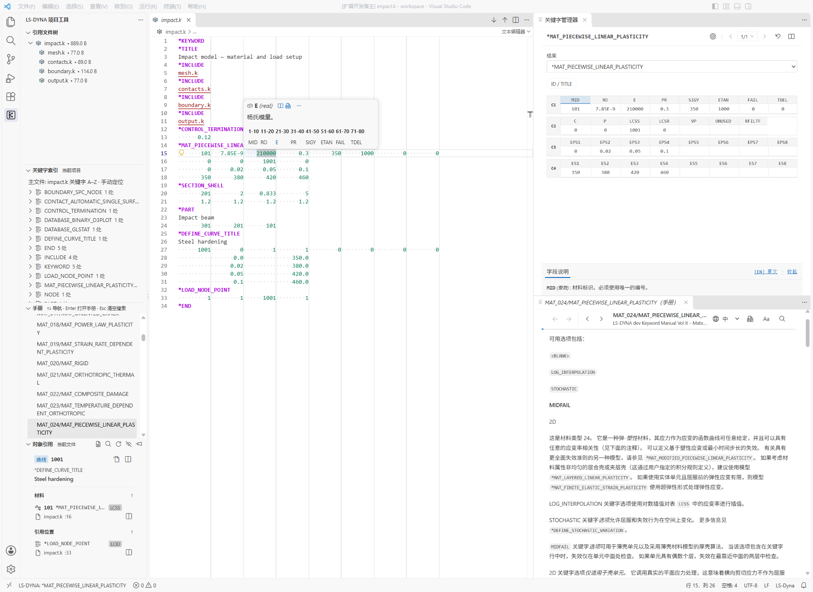
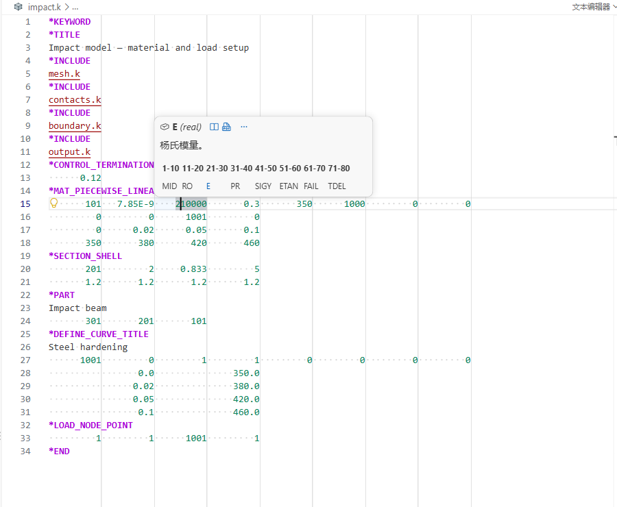
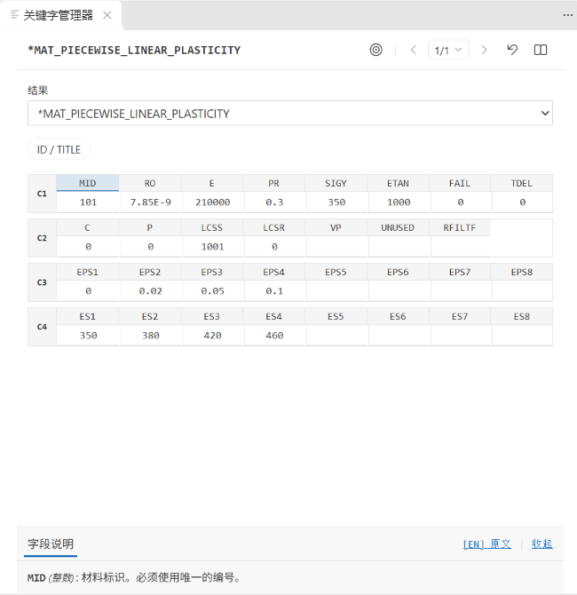
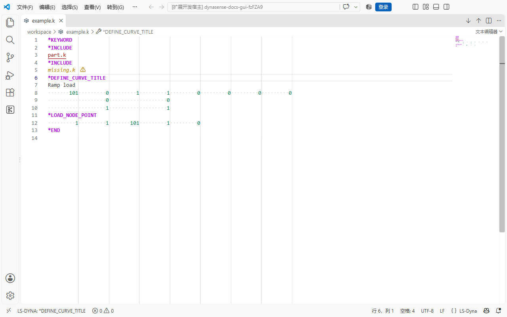

# DynaSense (LS-DYNA Studio)

  
  <h3>专为 LS-DYNA 仿真工程师打造的 VS Code 关键字文件增强工具</h3>
  
LS-DYNA (.k) 关键字文件辅助编辑，官方手册与参数说明快捷查询。

[English Version](README.md) | [中文说明](README_zh.md) | [产品介绍](https://pencilq.com/dynasense/)

---

## 快速上手

### 3 步开始使用

1. **安装插件**：在 VS Code 插件市场搜索 DynaSense 并安装。
2. **打开模型文件**：打开任意 .k、.key 或 .dyna 关键字文件（主文件或 Include 子文件均可）。
3. **开始高效编辑**：
   - 输入 `*` 快速补全关键字及其卡片格式；
   - 鼠标悬停在字段上直接查看参数释义；
   - 在侧边栏的 **LS-DYNA 项目工具** 中一键扫描模型层级。

### 常用快捷键速查

| 快捷键 | 功能 | 说明 |
| :--- | :--- | :--- |
| Tab / Shift+Tab | 字段跳格 | 像 Excel 一样在卡片字段间快速切换 |
| Delete / Backspace | 防串位清空 | 清空已选中的受支持字段并补齐空格，保持后续字段位置 |
| `$` 或 `$#` | 生成注释头 | 一键补全卡片的字段名注释头 |
| Ctrl + / | 切换行注释 | 快速为当前行添加或去除 LS-DYNA 的 `$` 注释符 |
| Ctrl + Alt + Up/Down | 跳转关键字 | 快速跳到上一个 / 下一个关键字 |
| F2 | 重命名参数 | 在当前文件中一键重命名 &param 参数 |

在引用文件树中扫描主文件后，可在支持的数值字段中输入 `&` 补全参数。支持“转到定义”、“查看定义”和“查找引用”在已扫描的引用文件树中导航参数。

---

## 核心功能特色

### 1. 定宽卡片编辑：按字段跳转与清空

编辑定宽关键字文件时，插入或删除字符可能改变后续字段的位置，导致数值被读入错误字段。

DynaSense 为 LS-DYNA 标准卡片提供了专用的定宽保护机制：
- **智能跳格**：按 Tab 键在数据行的各个字段之间跳转，输入覆盖经 Tab 选中的字段；输入 `*` 或 `$` 保留普通编辑行为。
- **防串位保护**：按 Delete 或 Backspace 清空已选中字段时会自动填充空格，后续字段稳固保持在原本的列宽内。
- **关键字卡片管理器**：悬停点击即可打开卡片编辑面板，直观修改字段并实时对比改动前后差异，确认无误再写入文件。

### 2. 悬停即看中文手册与载荷曲线：无需切屏翻查几千页 PDF

- **随手查手册**：鼠标悬停在受支持的关键字或参数字段上，立即显示中文说明与物理含义，调参再也不用去几千页的官方 PDF 里翻找。
- **载荷曲线直观预览**：鼠标悬停在 `*DEFINE_CURVE` 对应的曲线 ID 字段上，直接在编辑器中绘制出曲线图及受支持的表格预览，曲线趋势一目了然。
- **分栏对照阅读官方手册**：支持在关键字文件旁直接并排打开本地手册阅读器，边改模型边对照官方文档。

### 3. 整车 Include 树状导航

整车或复杂子系统模型往往由数十个甚至上百个 `*INCLUDE` 子文件组成：
- **层级一目了然**：打开主文件后一键扫描，侧边栏生成已识别的树状引用结构，双击即可快速定位并打开目标子文件。
- **跨文件参数与路径解析**：自动识别 `*INCLUDE_PATH`，支持参数在主文件和子文件之间的继承关系分析。

---

## 本地手册配置

完整的官方手册支持在本地离线查看：

| 手册包 | 下载地址 |
| :--- | :--- |
| **双语版** | [下载 lsdyna-manual-pack-bilingual.zip](https://github.com/hqyyqh/vscode-lsdyna/releases/download/2.0.7.3/lsdyna-manual-pack-bilingual.zip) |
| **英文版** | [下载 lsdyna-manual-pack-en.zip](https://github.com/hqyyqh/vscode-lsdyna/releases/download/2.0.7.3/lsdyna-manual-pack-en.zip) |

手册包更新日期：2026-10-18。

**官方文档：** [Ansys LS-DYNA 官方手册下载页](https://lsdyna.ansys.com/manuals-download/)提供官方原版文档；上方 ZIP 为供插件使用的本地手册包。

中文与中英对照内容需要包含译文的双语手册包；切换界面语言不会给英文包添加译文。编辑器中的说明与翻译供查阅辅助，技术内容以官方 PDF 为准。

### 配置步骤：
1. 下载手册包并完整解压到本地固定目录（例如 D:\LS-DYNA\Manuals）。
2. 在 VS Code 中按 Ctrl + Shift + P 打开命令面板，输入并运行 **设置 LS-DYNA 手册目录**。
3. 点击**选择目录**，选择包含 manifest.json 的解压根目录。
4. 运行 **LS-DYNA: 打开手册阅读器** 或在侧边栏点击 **手册** 即可开始阅读。

> **小技巧（Windows 用户）：** 将 [SumatraPDF.exe](https://www.sumatrapdfreader.org/free-pdf-reader) 放入解压后的手册根目录或 pdf 子目录下，点击手册链接可精准跳转至官方 PDF 对应的页码。

---

## 常用设置

大部分功能开箱即用。如需个性化调整，可在 VS Code 设置中搜索 LS-DYNA：

- lsdyna.manualsDir：本地解压后的手册包目录路径。
- lsdyna.language：界面与悬停说明的显示语言（默认为跟随 VS Code）。
- lsdyna.enableCellEditProtect：是否启用定宽字段防串位保护（默认开启）。
- lsdyna.enableTabNavigation：是否启用 Tab 键字段跳格（默认开启）。

全部设置与默认值

设置界面现提供 29 项选项：12 项日常选项和 17 项高级选项。退出公开设置的缓存参数仍兼容已有的明确配置，并沿用原有上下限；新用户使用内置默认值。VS Code 可能将旧 JSON 键标记为未知。变更标记统一采用 250 毫秒更新延迟。可在配置提示中选择**不再提醒**；已有的 `lsdyna.health.showFirstRunNotice: false` 仍受尊重。原有的未审核数据设置不再启用未经审核的数据，开发调试需使用已有的环境变量入口。

原有的 `lsdyna.scanner.fullScanLargeFiles` 开关已退出设置：关键字和引用指令发现本就读取整个文件，包括大文件的中间部分，已有开关值不影响这一行为。取消操作、扫描预算和不完整结果提示仍然有效；这不代表对象引用分析一定完整。

如需清理旧配置，请打开 **首选项：打开用户设置(JSON)**，并同时检查工作区设置。`lsdyna.scanner.fullScanLargeFiles` 和 `lsdyna.changeMarks.debounceMs` 已不再控制行为，可以移除。如果仍需关闭配置提示，请保留已有的 `lsdyna.health.showFirstRunNotice: false`。删除旧缓存上限前，请先查看[兼容默认值和迁移说明](CONTRIBUTING.md#legacy-cache-settings--旧版缓存兼容设置)。插件不会自动改写你的设置。

### 编辑

| 设置 | 默认值 | 说明 |
| --- | --- | --- |
| `lsdyna.enableTabNavigation` | `true` | 启用 LS-DYNA 卡片中的智能 Tab 跳转和字段覆盖选中。关闭后，Tab 只插入普通空格或制表符。 |
| `lsdyna.enableCellEditProtect` | `true` | 开启后，使用 Delete 或 Backspace 清空选中的定宽字段时会填充空格，后续字段不会左移。只有字段经 Tab 选中后，输入才会覆盖整个字段；输入 * 或 `$` 始终遵循普通编辑行为。此设置不依赖 Tab 跳转。 |
| `lsdyna.enableFieldHover` | `true` | 鼠标停留在定宽卡片字段上时显示字段说明。若不希望改数时频繁弹出说明，可关闭此项，并从 DynaSense 快捷操作中重新开启。 |
| `lsdyna.columnGuides.enabled` | `true` | 在已确认的固定宽度字段边界显示列辅助线。 |

### 外观

| 设置 | 默认值 | 说明 |
| --- | --- | --- |
| `lsdyna.changeMarks.enabled` | `true` | 在编辑器左侧标记栏显示本次编辑的变更。默认情况下，琥珀色表示未保存，绿色表示文件打开后已保存；实心条表示修改，空心条表示新增，三角形表示附近有删除行。无需 Git。 |
| `lsdyna.changeMarks.colorScheme` | `"adaptive"` | 为所有本次变更标记选择一套配色。每个预设都会自动适配浅色、深色、高对比度和高对比度浅色主题。 |
| `lsdyna.changeMarks.showLineBackground` | `true` | 为有标记的行添加极淡的整行底色。关闭后仅保留标志边栏中的标记。 |
| `lsdyna.statusBar.level` | `"simple"` | 状态栏中显示当前 LS-DYNA 文件信息的详细程度。关闭时隐藏；简洁模式显示问题或当前关键字；详细模式还显示字段序号和最近一次引用文件树扫描根目录。 |
| `lsdyna.codeLens.showOnAllKeywords` | `false` | 在每个 LS-DYNA 关键字上方显示“选中卡片”和“格式化”操作；支持可选后缀的关键字还会显示“配置选项”。关闭后仍可从关键字悬停提示、编辑器右键菜单或命令面板执行这些操作。 |
| `lsdyna.navigation.pulseOnJump` | `true` | 跳转到关键字引用后短暂高亮目标行。 |

### 手册与语言

| 设置 | 默认值 | 说明 |
| --- | --- | --- |
| `lsdyna.manualsDir` | `"lsdyna_manual_pack"` | 手册包的根目录，其中应包含运行时索引和 PDF 手册。可填写绝对路径或相对于工作区的路径。在 Windows 上，将 SumatraPDF.exe 放在包根目录或其 pdf 子目录中，可精确跳转到指定页。 |
| `lsdyna.language` | `"auto"` | 设置插件运行时界面、悬停提示和消息的语言。命令名称和设置说明跟随 VS Code 显示语言。 |

### 高级：工程规则

| 设置 | 默认值 | 说明 |
| --- | --- | --- |
| `lsdyna.additionalExtensions` | `[".k",".key",".dyna"]` | 作为 LS-DYNA 文件处理的其他扩展名。 |
| `lsdyna.ignoreFormattingKeywords` | `[]` | 不执行显式 LS-DYNA 格式化命令、Tab 智能对齐和字段注释补全的关键字或前缀。 |
| `lsdyna.customValidKeywords` | `["*END","*TITLE","*CASE_BEGIN","*CASE_END"]` | 不会被报告为未知的其他有效关键字。请包含前导星号（例如 '`*END`'）；在末尾添加通配符（例如 '`*MAT_*`'）可匹配具有该前缀的全部关键字。也可通过悬停提示或快速修复添加。 |
| `lsdyna.unknownKeywordSeverity` | `"error"` | 不在内置库或自定义有效列表中的关键字所使用的诊断级别。不影响以 ** 开头的格式错误或小写关键字警告。 |
| `lsdyna.warnLowercaseKeyword` | `false` | 当关键字含小写字母（如 *node）时给出警告。LS-DYNA 关键字大小写不敏感，故默认关闭；若团队约定关键字全大写可开启。 |
| `lsdyna.include.pathCaseCheck` | `"crossPlatform"` | 如何检查 `*INCLUDE` 和 `*INCLUDE_PATH` 的路径大小写。Windows 常能打开大小写不一致的路径，Linux 上的 LS-DYNA 通常不能。 |
| `lsdyna.autoFormat` | `"disabled"` | 实验性：选择 LS-DYNA 卡片自动格式化的触发时机。除非你接受光标离开当前行时自动改写，否则建议保持关闭。 |
| `lsdyna.clearAutoIndentOnEnter` | `false` | 按 Enter 后清除编辑器自动复制的缩进。默认关闭，以保留有意缩进和粘贴内容。 |

### 高级：显示与性能

| 设置 | 默认值 | 说明 |
| --- | --- | --- |
| `lsdyna.changeMarks.customUnsavedColor` | `"#e2a03a"` | 未保存修改的自定义颜色，格式为 #RRGGBB。仅在“变更标记: 配色方案”选择“自定义”时使用。 |
| `lsdyna.changeMarks.customSavedColor` | `"#89d185"` | 文件打开后已保存修改的自定义颜色，格式为 #RRGGBB。仅在“变更标记: 配色方案”选择“自定义”时使用。 |
| `lsdyna.changeMarks.showOverviewRuler` | `true` | 同时在滚动条概览标尺上显示变更标记。 |
| `lsdyna.changeMarks.showMinimap` | `true` | 使用所选配色在缩略图中显示未保存和打开文件后已保存的修改。修改、新增和删除的形状仍仅在编辑器左侧标记栏中区分。 |
| `lsdyna.changeMarks.maxLineCount` | `100000` | 文档行数超过此值时不计算变更标记（保护超大网格文件）。 |
| `lsdyna.largeFile.enableRendering` | `true` | 无论文件有多少行，都保持语法高亮、悬停说明和补全功能。处理超过 10 万行的文件时，可关闭此项以节省内存；显式格式化命令另有不可绕过的安全上限。 |
| `lsdyna.hover.previewMaxLines` | `20` | `*INCLUDE` 文件悬停预览中显示的最大行数。 |
| `lsdyna.cache.entityIndexMemoryMaxMiB` | `"auto"` | 模型索引的内存管理预算（MiB），由查询缓存、未保存文档索引、结果页、索引构建和恢复批次及 SQLite 共用。此值不是 VS Code 进程总内存上限。重启扩展后生效。 |
| `lsdyna.cache.entityIndexDiskMaxMiB` | `4096` | 模型索引共用的磁盘预算（MiB），包括数据库、日志和临时构建文件。预算不足时，查询回退到扫描方式。重启扩展后生效。 |

---

## 交流与反馈

欢迎在 GitHub 上提交使用反馈或改进建议！

- **问题反馈与交流**：[提交 GitHub Issue](https://github.com/hqyyqh/vscode-lsdyna/issues)

---

## 致谢 (Acknowledgments)

本项目基于开源社区的工作构建与演进，特别感谢以下项目与贡献者：

- **[osullivryan/vscode-lsdyna](https://github.com/osullivryan/vscode-lsdyna)**：VS Code 的早期 LS-DYNA 扩展。感谢作者 **Ryan O'Sullivan** (@osullivryan) 以及核心贡献者 **@DCHartlen**、**@maxiiss**、**@yshl** 奠定的语法高亮和编辑基础。
- **[ansys/pydyna](https://github.com/ansys/pydyna)**：Ansys 开源的 Python 接口库，为本项目提供了结构化的关键字卡片格式与定义数据。
- **[vim-lsdyna](https://github.com/gradzikb/vim-lsdyna)**：作者 **@gradzikb** 开发的 Vim 插件，为卡片定宽排版逻辑提供了参考。
