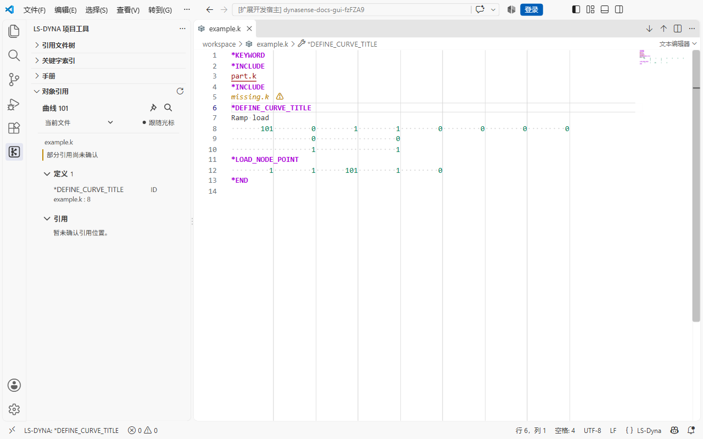

# DynaSense (LS-DYNA Studio)

  
  <h3>面向 VS Code 的 LS-DYNA 关键字文件编辑器</h3>
  
为 CAE 工程师提供关键字说明、定宽卡片编辑、引用文件树、对象预览和本地手册。

[English Version](README.md) | [中文说明](README_zh.md)

---

## 快速开始

需要 VS Code 1.100.0 或更新版本。本页介绍 3.2.0 开发版本；商店版本可能尚未包含部分功能，版本状态见[变更记录](CHANGELOG.md)。

安装 DynaSense 后，可以按以下步骤开始：

1. **打开关键字文件** — 打开 `.k`、`.key` 或 `.dyna` 文件，主文件和引用文件均可。
2. **插入关键字** — 输入 `*`，从列表中选择关键字并插入对应的卡片格式。
3. **按字段编辑** — 在数据行按 `Tab` / `Shift+Tab`。Delete 清空选中字段且不移动后续字段；经 Tab 选中后，输入只替换该字段。
4. **查看说明和引用** — 将鼠标悬停在关键字、字段、参数、曲线 ID 或表格 ID 上。
5. **扫描模型** — 打开活动栏中的 **LS-DYNA 项目工具** → **引用文件树**，然后从主文件开始扫描。

---

## 核心工作流程

### 安全地编辑关键字卡片

- 关键字补全模板使用开源项目 [ansys/pydyna](https://github.com/ansys/pydyna) 的数据；具体格式和编辑范围见[功能支持范围](SUPPORT.md)。
- 代码片段可直接插入排好格式的卡片。对于支持的关键字，可通过悬停操作选择卡片、格式和可选字段。
- `Tab` 按支持的卡片格式在字段间移动。到达最后一个字段后，再按 Tab 会回到**同一数据行**的第一个字段，不会新建或进入下一行。
- 输入 `$` 或 `$#` 可生成对齐的字段标题注释；`Ctrl+/` 可添加或删除 LS-DYNA 使用的 `$` 行注释标记。
- 可按需要整理卡片或选中内容。请使用 DynaSense 自带的排版命令；本扩展不提供 VS Code 通用的文档或选区格式化命令。无法安全处理的卡片格式不会被自动修改。

### 在关键字管理器中审查修改

通过关键字悬停或快捷操作打开管理器，选择当前文件或项目中的实例，查看可用卡片布局和字段帮助，然后编辑草稿。**查看修改**会列出准备写入的修改，包括占用文件中相同位置的字段所产生的联动修改。**应用修改**应用当前预览，**取消修改**放弃尚未应用的内容。撤销、重做、保存和关闭重开沿用编辑器流程。文档发生变化或只读时，须恢复为当前可写状态后才能应用。

管理器使用内置的卡片格式。尚未验证的格式可以查看，但不能通过管理器自动修改，详见[功能及格式支持边界](SUPPORT.md)。

图中展示联动字段的修改预览，仅用于说明编辑操作，不是可直接求解的完整模型。

### 查看本次编辑的修改

- 无需使用 Git，也能查看本次编辑的变化。默认的琥珀色/绿色会自动适配浅色、深色和高对比度主题；也可以在 VS Code 设置中选择橙色/蓝色、红色/蓝色、高对比度或自定义配色。不同形状用于区分修改、插入和删除的行。
- 可跳到上一个或下一个修改位置，对比打开时版本或当前未保存内容，也可以重设比较起点。
- 为保持编辑流畅，超大文件会限制扫描范围，并可自动跳过修改标记。只有确实需要完整索引时，才建议开启大文件完整扫描并接受更长的加载时间。
- 为避免编辑卡顿，修改标记优先比较发生变化的部分。大范围改写或很长的重复行可能使用近似的插入、删除标记，未变化的前后区域仍保持对齐。这只影响标记显示，不影响文件内容、保存或撤销。

### 检查卡片结构

在关键字管理器中选择**卡片条件**，可查看需要哪些卡片及其适用条件。判断依据是当前文件，尚未应用的修改不计入；手册与编辑表格的卡片编号可能不同。应用前请点击**查看修改**核对实际变化。

运行**检查当前关键字结构**，可将已确认的结构错误列入 VS Code 的“问题”面板。自动检查有文件大小和检查数量限制；较大文件可以逐个关键字手动检查。条件无法确定、格式不支持或超出检查范围时，没有报错不代表模型已经验证通过，更不能代替 LS-DYNA 求解检查。具体限制见[功能支持范围](SUPPORT.md#结构检查范围)。

### 管理 `*INCLUDE` 文件

- 在 `*INCLUDE` 下方的文件名行输入 `/` 或 `\`，可逐层浏览文件夹。输入文件名或其中一部分（例如 `LC_Front`），可在所有子目录中查找。选中后使用正斜杠路径，便于将模型传到 Linux。
- 从主文件扫描引用文件树后，主文件及上层引用文件中的 `*INCLUDE_PATH` 和 `*INCLUDE_PATH_RELATIVE` 会应用到下级文件。如果扫描前单独打开一个引用文件，只能使用该文件所在目录和它自己声明的路径。
- 文件关系就绪后会先显示引用文件树，对象引用继续在后台分析；正在分析或已取消不代表引用结果完整。再次扫描会校验文件并复用未变结果；需要主动丢弃已有扫描结果时可使用清理缓存命令。
- 带下划线的路径表示已在本机找到并可打开。末尾的警告标记 表示按当前已知目录未找到文件，也可能是该文件尚未同步到本机。
- 引用文件树会把真正的循环引用作为错误报告。同一个材料文件被多个上级文件引用是正常情况，不会被当作循环。
- 将鼠标悬停在路径上可预览文件开头。路径超过 LS-DYNA 三行、236 字符的限制时，会在提交计算前提示。

在 Windows 上，即使磁盘目录是 `Sub/Part.k`，`sub/part.k` 也可能正常打开；Linux 通常要求大小写完全一致。默认的 `crossPlatform` 检查会保持本地跳转并提示差异；最终提交到 Linux 前可改为 `strict` 严格检查。严格模式会把大小写不一致列为错误，并禁用对应文件的跳转。

### 检查参数、曲线和引用对象

- 将鼠标悬停在 `&name` 上，可查看当前文件中的参数来源；扫描项目后，还可查看该参数在选定或唯一主文件环境中、当前位置实际采用的值。
- 将鼠标悬停在支持的曲线或表格引用字段上，可查看定义以及一维曲线或组合三维图形预览。如果存在多个可能目标，DynaSense 会列出候选项，不会自动选择其中一个。
- 对已确认的引用可使用**转到定义**。如果一个文件可能属于多个模型，请运行**选择主文件**，确保按目标模型计算继承的参数和引用。
- `F2` 可在当前文件内重命名参数；`Ctrl+Alt+Up` / `Ctrl+Alt+Down` 可跳到上一个或下一个关键字。
- 如果某个有效关键字比内置库更新，可通过悬停操作、快速修复或 DynaSense 快捷操作，把它加入“有效关键字”名单。

打开**对象引用**视图，选择对象类型（例如部件或曲线）、输入 ID，再选择当前文件或项目范围并查询。项目范围需要先从主文件扫描引用文件树。结果分别列出定义位置和引用位置；有多个候选、结果不完整或文件已修改时，请先阅读提示，必要时重新扫描或刷新。固定查询便于以后再次查看，不会冻结文件内容或保证结果始终有效。

### 浏览大模型和关键字索引

运行**在 DynaSense 大文件视图中打开**，以只读方式浏览文件、跳转到指定行、搜索文字或查询支持的字段和 ID。文件在外部修改后需要重新加载。关键字索引支持原始顺序、字母和分类布局、分页以及光标跟随。大文件浏览不会修改文件内容。

关键字索引和对象引用的“跟随光标”在**每次启动扩展时均关闭**。需要时主动开启，仅在对应视图可见时运行，不会自动打开侧栏。关键字索引可见时随文件变化更新列表，跟随关闭时不会自动选中或滚动定位；隐藏时延后更新。对象引用保留上次查询，直到主动搜索、刷新、切换查询范围或开启跟随；相关内容编辑后仅标记需要刷新。

### 在关键字文件旁阅读本地手册

完整手册包支持关键字/标题搜索、全文搜索、章节目录、独立字号调整、阅读进度、图片放大和 PDF 页码跳转。双语包还可在有译文的章节中切换中英文并预览句子译文。阅读器会恢复上次位置，默认在关键字文件旁打开，便于对照查看。

当前下载地址见[手册配置](#手册配置)。手册包必须完整解压，阅读器需要同时使用其中的 `manifest.json`、索引、图片和 PDF 文件。

---

## 手册配置

由于体积较大，PDF 手册不包含在 `.vsix` 中。下方提供 **2026-08-04 英文手册包**。原双语包下载地址目前不可用（核查日期：2026-09-30）；如果已有完整的双语包，仍可选择该文件夹阅读中文内容和预览译文。

| 手册包 | 下载 |
| --- | --- |
| **英文原版** | [下载 `lsdyna-manual-pack-en_20260804.zip`](https://github.com/hqyyqh/vscode-lsdyna/releases/download/2.0.7.3/lsdyna-manual-pack-en_20260804.zip) |
| **双语：英文原版 + 中文翻译** | 暂未确认可用的公开下载地址，请查看[项目发布页](https://github.com/hqyyqh/vscode-lsdyna/releases)是否已恢复提供。 |

> **权威性说明：** 只有 PDF 手册是官方权威资料。内置阅读器中的文字、中文翻译、悬停摘要、搜索结果和索引仅用于辅助阅读；如内容存在差异，请以 PDF 手册为准。

1. 下载一个手册包并完整解压到固定的本机目录，不要直接选择压缩包。
2. 运行**设置 LS-DYNA 手册目录**，或在 VS Code 设置中修改 `lsdyna.manualsDir`。
3. 选择解压后包含 `manifest.json` 的最外层文件夹。
4. 运行 **LS-DYNA: 打开手册阅读器**，或从活动栏的**手册**视图打开章节。

**注意事项**

- 在 Windows 上，可使用 [SumatraPDF](https://www.sumatrapdfreader.org/free-pdf-reader) 打开官方 PDF 并跳到指定页；将 `SumatraPDF.exe` 放在手册包文件夹或其 `pdf` 子文件夹中。SumatraPDF **仅支持 Windows**。
- VS Code 内置手册阅读器仍可在 Windows、macOS 和 Linux 上使用。非 Windows 系统会调用默认 PDF 阅读器，是否能准确跳到指定页取决于该阅读器。
- 请保持解压后的内部目录结构不变。可以移动或重命名最外层文件夹，但不要重命名或删除其中的 `manifest.json`、索引、图片或 PDF 文件，否则可能影响搜索、图片显示或 PDF 链接。
- 英文包只包含英文原版。中文内容和译文预览需要完整双语包；切换界面语言不会自动增加手册译文。

---

## 设置

在 VS Code 设置中搜索 `LS-DYNA`。通常只需设置手册目录；其余选项可按需要调整。下面按用途列出全部设置，默认值与扩展一致。展开对应分组即可查看用途和默认值。

<strong>编辑与说明</strong>

- `lsdyna.manualsDir`

  **默认值：** `"lsdyna_manual_pack"`

  选择完整解压且包含 `manifest.json` 的手册包文件夹。

- `lsdyna.language`

  **默认值：** `"auto"`

  选择面板、悬停说明和消息的语言。命令名称与设置说明跟随 VS Code；手册译文取决于安装的手册包。

- `lsdyna.enableTabNavigation`

  **默认值：** `true`

  关闭后，Tab 按编辑器设置插入空格或制表符。

- `lsdyna.enableCellEditProtect`

  **默认值：** `true`

  用空格清空已选中的定宽字段，避免 Delete/Backspace 移动后续字段。

- `lsdyna.enableFieldHover`

  **默认值：** `true`

  希望界面更安静时关闭；引用路径、关键字和参数说明仍会保留。

- `lsdyna.hover.previewMaxLines`

  **默认值：** `20`

  限制引用文件预览的行数。

- `lsdyna.autoFormat`

  **默认值：** `"disabled"`

  离开数据行后自动整理卡片的试验功能。

- `lsdyna.clearAutoIndentOnEnter`

  **默认值：** `false`

  如需清除 Enter 后自动复制的缩进，可主动开启。

- `lsdyna.ignoreFormattingKeywords`

  **默认值：** `[]`

  不参与排版、Tab 对齐和字段标题注释补全的关键字或前缀。

- `lsdyna.codeLens.showOnAllKeywords`

  **默认值：** `false`

  在每个关键字上方显示附加操作。

- `lsdyna.keywordManager.allowUnauditedCatalog`

  **默认值：** `false`

  仅供开发调试：加载尚未审核的卡片格式，不会因此允许编辑未验证的格式。日常使用请保持关闭。

<strong>文件与检查</strong>

- `lsdyna.additionalExtensions`

  **默认值：** `[".k",".key",".dyna"]`

  按 LS-DYNA 关键字文件处理的扩展名；需要时可加入 `.asc`。

- `lsdyna.include.pathCaseCheck`

  **默认值：** `"crossPlatform"`

  提交到 Linux 且必须严格匹配大小写时，改为 `strict`。

- `lsdyna.customValidKeywords`

  **默认值：** `["*END","*TITLE","*CASE_BEGIN","*CASE_END"]`

  不应被报告为未知的已确认关键字。

- `lsdyna.unknownKeywordSeverity`

  **默认值：** `"error"`

  求解器版本比内置库更新时，可降为警告、提示或关闭。

- `lsdyna.warnLowercaseKeyword`

  **默认值：** `false`

  关键字不是大写时发出提示。

<strong>修改标记与外观</strong>

- `lsdyna.changeMarks.enabled`

  **默认值：** `true`

  显示本次编辑产生的修改。

- `lsdyna.changeMarks.colorScheme`

  **默认值：** `"adaptive"`

  选择一套自动适配主题的预设，或选择 `custom`；所有预设都会随浅色/深色主题切换。

- `lsdyna.changeMarks.customUnsavedColor`

  **默认值：** `"#e2a03a"`

  仅供自定义方案使用的未保存颜色（`#RRGGBB`）。

- `lsdyna.changeMarks.customSavedColor`

  **默认值：** `"#89d185"`

  仅供自定义方案使用的打开文件后已保存颜色（`#RRGGBB`）。

- `lsdyna.changeMarks.maxLineCount`

  **默认值：** `100000`

  文件超过此行数时跳过修改标记。

- `lsdyna.changeMarks.debounceMs`

  **默认值：** `250`

  编辑后等待相应毫秒数再刷新标记。

- `lsdyna.changeMarks.showOverviewRuler`

  **默认值：** `true`

  在编辑器右侧概览尺显示修改。

- `lsdyna.changeMarks.showLineBackground`

  **默认值：** `true`

  为修改行增加浅色背景。

- `lsdyna.changeMarks.showMinimap`

  **默认值：** `true`

  在缩略图中显示已保存和未保存的修改。

- `lsdyna.navigation.pulseOnJump`

  **默认值：** `true`

  跳转后短暂突出显示目标位置。

- `lsdyna.statusBar.level`

  **默认值：** `"simple"`

  选择关闭、简要或详细的当前文件状态。

- `lsdyna.health.showFirstRunNotice`

  **默认值：** `true`

  首次使用时显示一次配置提示。

<strong>大文件与扫描结果存储</strong>

- `lsdyna.largeFile.enableRendering`

  **默认值：** `true`

  关闭后，超过 10 万行的文件会停用语法高亮、悬停说明和补全，以减少内存占用。

- `lsdyna.scanner.fullScanLargeFiles`

  **默认值：** `false`

  只有需要超大文件的完整索引时才开启。

- `lsdyna.cache.memoryMaxMiB`

  **默认值：** `48`

  限制保留项目扫描结果所用的内存（MiB）。界面另保留最多 32 MiB 的项目摘要。

- `lsdyna.cache.projectSnapshotDiskMaxMiB`

  **默认值：** `256`

  限制保留完整项目扫描结果所用的磁盘空间（MiB）。

- `lsdyna.cache.fileScanDiskMaxMiB`

  **默认值：** `256`

  限制保留各文件扫描结果所用的磁盘空间（MiB）。

- `lsdyna.cache.fileScanMemoryMaxMiB`

  **默认值：** `16`

  限制保留各文件扫描结果所用的内存（MiB）。

- `lsdyna.cache.maxAgeDays`

  **默认值：** `30`

  设置磁盘上的扫描结果最多可闲置多少天。

扫描结果保存在内存或磁盘中，可减少重复扫描。这些存储上限不是整个扩展的内存或磁盘占用上限。`lsdyna.cache.*` 设置在重启扩展后生效；日常使用建议保留默认值。

自定义扩展名还应配置 VS Code 的 `files.associations`，例如 `"*.my_ext": "lsdyna"`。推荐通过配色方案统一设置修改标记；已有的 `workbench.colorCustomizations` 中 `lsdyna.changeMarks.unsaved` 和 `.saved` 在自动配色模式下仍然有效。

> **提交模型前：** 从正确的主文件扫描引用文件树 → 处理所有引用文件缺失提示 → 消除循环引用 → 提交到 Linux 时严格检查路径大小写 → 确认提交目录与扫描时使用的 `*INCLUDE_PATH` 结构一致。

---

## 致谢与贡献者

本项目由 [hqyyqh](https://github.com/hqyyqh) 维护，是对 LS-DYNA VS Code 编辑器生态的深度定制。

- **上游项目：** [osullivryan/vscode-lsdyna](https://github.com/osullivryan/vscode-lsdyna)；感谢 [osullivryan](https://github.com/osullivryan)、[DCHartlen](https://github.com/DCHartlen)、[maxiiss](https://github.com/maxiiss) 和 [yshl](https://github.com/yshl)。
- **关键字数据：** [ansys/pydyna](https://github.com/ansys/pydyna)。
- **参考项目：** [vim-lsdyna](https://github.com/gradzikb/vim-lsdyna) 以及其他 LS-DYNA 编辑器社区项目。
